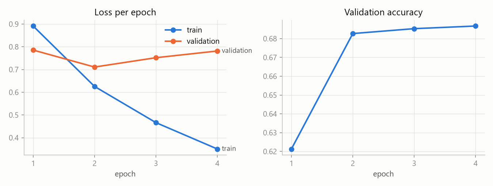
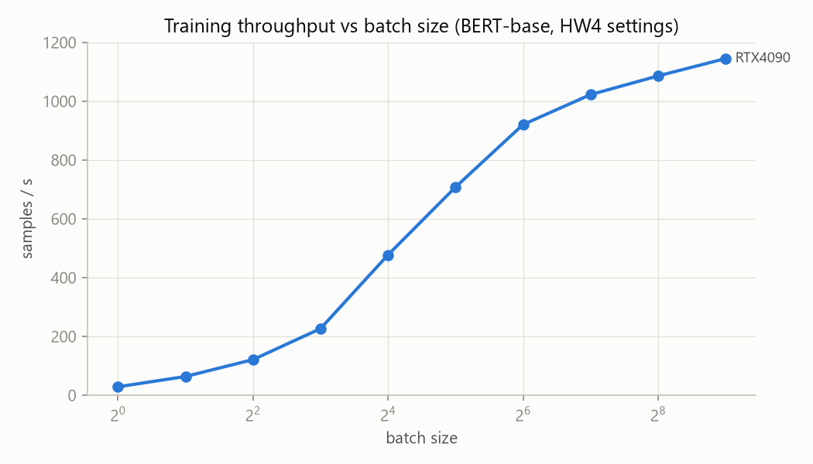
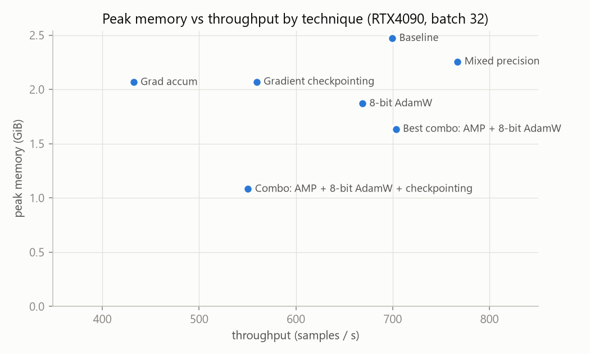

# HW4.a / HW4.5 results

## HW4.a - BERT sentiment classifier

### NVIDIA GeForce RTX 4090

**Data:** cardiffnlp/tweet_eval (sentiment), splits train+validation+test concatenated. Working subset = rows **384-5383** (0-based, inclusive; 5000 rows, 0 dropped as empty). SEED=1384. Split 70/15/15 -> 3500/750/750 (stratified). Classes: {'negative': 779, 'neutral': 2283, 'positive': 1938}.

| Epoch | Train loss | Val loss | Val acc | Epoch time (s) | samp/s |
|---|---|---|---|---|---|
| 1 | 0.8913 | 0.7855 | 0.6213 | 5.29 | 661.5 |
| 2 | 0.6255 | 0.7108 | 0.6827 | 4.92 | 711.1 |
| 3 | 0.4663 | 0.7519 | 0.6853 | 5.04 | 695.0 |
| 4 | 0.3503 | 0.7814 | 0.6867 | 5.02 | 697.4 |

Validation loss stopped improving after **epoch 2** (best val accuracy at epoch 4). Training continued 2 epoch(s) past that point, costing 10.06 s of GPU time; validation loss rose from 0.7108 to 0.7814 and test accuracy went from 0.6907 (best checkpoint) to 0.688 (final epoch).

**Test accuracy** 0.6907 (best-val checkpoint; 0.6907 after save + reload).

Confusion matrix (rows = true, columns = predicted):

| true \ pred | negative | neutral | positive |
|---|---|---|---|
| negative | 73 | 35 | 9 |
| neutral | 35 | 238 | 69 |
| positive | 11 | 73 | 207 |

| Class | Precision | Recall | F1 | Support |
|---|---|---|---|---|
| negative | 0.6134 | 0.6239 | 0.6186 | 117 |
| neutral | 0.6879 | 0.6959 | 0.6919 | 342 |
| positive | 0.7263 | 0.7113 | 0.7188 | 291 |

**Worst class: negative** (lowest F1). Five misclassified test examples:

| Row | Tweet | True -> Pred | Diagnosis |
|---|---|---|---|
| 481 | @user even I didn't know it's 18th sept at KL Live to be exact :p | negative -> neutral | No negative words at all and a playful ':p'; the gold 'negative' label looks debatable (label noise), so neutral is a defensible prediction. |
| 5017 | Assam Congress leader Nilomoni sen deka reffered Smritini Irani as PM's 2nd wife..And Still Rahul Gandhi talks about women Empowerment. | negative -> neutral | Negativity is carried by irony ('And still ... talks about women empowerment') around a factual report full of names; the model reads the surface as news-like and neutral. |
| 2512 | Don't want to hear Seth Rollins Speech about how great he is tomorrow bruh. | negative -> positive | Negation scoping: the model latched onto 'how great he is' and missed that 'Don't want to hear' flips it. |
| 4768 | "Not happy that I'm working through the advance screening tomorrow, so still have to wait OVER TWO WEEKS to see Paper Towns #wallofcow" | negative -> neutral | Explicit 'Not happy' is outweighed by positive-context words (advance screening, see Paper Towns); BERT under-weights the negation at the start. |
| 5144 | @user Hi, was offered the 6 months free Netflix last Tuesday and was told it takes 5 days to receive a code but haven't got anything" | negative -> neutral | A polite customer-service complaint phrased as a factual timeline ('was told... haven't got anything'); the grievance is implied, not stated with sentiment words. |

Custom inference with the reloaded model:

| Text | Prediction | Probabilities |
|---|---|---|
| just landed and my bag is already at the carousel, best flight ever | positive | {'negative': 0.02, 'neutral': 0.035, 'positive': 0.944} |
| three hours on the tarmac and nobody tells us anything | negative | {'negative': 0.516, 'neutral': 0.409, 'positive': 0.075} |
| the meeting got moved to thursday | neutral | {'negative': 0.084, 'neutral': 0.805, 'positive': 0.111} |
| oh great, another monday. exactly what i needed | positive | {'negative': 0.017, 'neutral': 0.054, 'positive': 0.929} |

**HW4.5 baseline (keep with this assignment):** peak GPU memory **2.472 GiB** allocated (2.967 GiB reserved), wall-clock training time **21.5 s** (20.27 s excluding per-epoch validation), batch 32, 4 epochs, fp32, AdamW lr 2e-05.

## HW4.a - Table HW4.1 Serving comparison

### RTX4090 - Qwen/Qwen2.5-1.5B-Instruct, 128 new tokens/request, bf16

| Configuration | Tokens/sec | p50 latency (ms) | p95 latency (ms) |
|---|---|---|---|
| HF pipeline, batch 1 | 63.1 | 2021.3 | 2092.0 |
| vLLM, batch 1 | 206.7 | 618.5 | 627.9 |
| vLLM, batch 8 | 1391.8 | 733.5 | 756.2 |
| vLLM, batch 32 | 5434.2 | 761.3 | 769.0 |

At the batch sizes tested, vLLM per-request latency never exceeded the HF baseline.

## HW4.5 Part A - Batch scaling to the memory wall

### NVIDIA GeForce RTX 4090 (23.99 GiB)

| Batch | Throughput (samp/s) | Peak alloc (GiB) | Peak reserved (GiB) | Time/epoch (s) |
|---|---|---|---|---|
| 1 | 28.9 | 2.061 | 2.279 | 121.1 |
| 2 | 63.9 | 2.062 | 2.279 | 54.81 |
| 4 | 121.3 | 2.067 | 2.336 | 28.87 |
| 8 | 226.7 | 2.066 | 2.27 | 15.44 |
| 16 | 477.5 | 2.088 | 2.264 | 7.33 |
| 32 | 708.2 | 2.472 | 2.77 | 4.94 |
| 64 | 920.8 | 3.726 | 4.012 | 3.8 |
| 128 | 1022.7 | 6.11 | 6.275 | 3.42 |
| 256 | 1086.3 | 10.978 | 11.125 | 3.22 |
| 512 | 1145.3 | 20.591 | 20.766 | 3.06 |

Largest batch that runs: **512** (OOM at 1024). Throughput reaches 95% of its peak (1145.3 samp/s) at **batch 512** and stops improving meaningfully beyond it.

_Only one card measured so far. Run this script on the second card to get the max-batch and VRAM ratios._

## HW4.5 Part B - Memory techniques, one at a time

### Table HW4.5.1 - NVIDIA GeForce RTX 4090 (23.99 GiB)

Throughput and peak memory are measured at the HW4 batch size (32) so the techniques do equal work; max batch is the largest power of two before OOM; accuracy is a full HW4 fine-tune with only that technique on.

| Technique | Max batch | Throughput (samp/s) | Peak memory (GiB) | Eval accuracy |
|---|---|---|---|---|
| Baseline (HW4 settings) | 512 | 699.6 | 2.472 | 0.688 |
| Mixed precision (bf16) | 512 | 767.0 | 2.256 | 0.6893 |
| Gradient checkpointing | 2048 | 559.5 | 2.07 | 0.688 |
| Gradient accumulation (8 x 16) | 128 effective | 432.3 | 2.066 | 0.6747 |
| 8-bit AdamW (bitsandbytes) | 512 | 668.8 | 1.87 | 0.684 |
| Best combo: AMP + 8-bit AdamW | 512 | 703.4 | 1.635 | 0.6867 |
| Combo: AMP + 8-bit AdamW + checkpointing | 4096 | 550.6 | 1.082 | 0.6867 |

Gradient accumulation: effective batch **128** on a physical batch of 8. Wall-clock for 20 optimiser steps: **5.922 s** (2.066 GiB) vs a direct batch of 128: 2.507 s, 6.11 GiB. Test accuracy 0.6747 (same lr as HW4, so fewer optimiser steps per epoch).

**Ranking: memory saved per unit of throughput lost** (GiB saved per 1% throughput lost; higher is better):

| Rank | Technique | Memory saved (GiB) | Throughput lost | GiB per 1% lost |
|---|---|---|---|---|
| 1 | Mixed precision (bf16) | +0.22 | -9.6% | no throughput cost |
| 2 | 8-bit AdamW (bitsandbytes) | +0.60 | +4.4% | 0.137 |
| 3 | Gradient accumulation | +4.04 | +57.7% | 0.070 |
| 4 | Gradient checkpointing | +0.40 | +20.0% | 0.020 |

Gradient checkpointing throughput cost: 699.6 -> 559.5 samp/s (**20.0% slower**) for 2.472 -> 2.07 GiB.

## HW4.5 Part C - Two cards at once (DDP)

_Pending: run `torchrun --nproc_per_node=1 hw45_partC_ddp.py` (single-GPU baseline)._

_Pending: run the instructor-assigned 2-GPU pairing, e.g. `torchrun --nproc_per_node=2 hw45_partC_ddp.py`._

## HW4.5 Part D - Serving re-run on real hardware

### RTX4090 - Qwen/Qwen2.5-1.5B-Instruct, 128 new tokens/request, bf16

| Configuration | Tokens/sec | p50 latency (ms) | p95 latency (ms) |
|---|---|---|---|
| HF pipeline, batch 1 | 62.9 | 2025.1 | 2112.6 |
| vLLM, batch 1 | 203.8 | 626.1 | 646.3 |
| vLLM, batch 8 | 1380.8 | 738.3 | 771.0 |
| vLLM, batch 32 | 5546.5 | 739.1 | 740.1 |

At the batch sizes tested, vLLM per-request latency never exceeded the HF baseline.

### KV-cache memory vs context length

**NVIDIA GeForce RTX 4090, HF transformers (measured), batch 8**, Qwen/Qwen2.5-1.5B-Instruct, 28 KiB of KV per token:

| Context | KV measured (GiB) | KV analytic (GiB) | Peak total (GiB) |
|---|---|---|---|
| 1024 | 0.227 | 0.219 | 3.607 |
| 2048 | 0.445 | 0.438 | 3.828 |
| 3072 | 0.664 | 0.656 | 4.049 |
| 4096 | 0.883 | 0.875 | 4.268 |
| 8192 | 1.758 | 1.75 | 5.26 |
| 16384 | 3.508 | 3.5 | 7.518 |
| 32768 | 7.008 | 7.0 | 12.033 |
| 58368 | 12.477 | 12.469 | 19.089 |

Longest context at batch 8 before OOM (HF): **58,368 tokens**.

**NVIDIA GeForce RTX 4090, vLLM**: KV pool 677,440 tokens (18.09 GiB at gpu_memory_utilization=0.9). At batch 8: memory allows 84,680 tokens/sequence, model allows 32,768 -> longest servable context **32,768**.

## HW4.5 Part E - Analysis and summary

**RTX4090.** One full fine-tune = the 70% training share of all 59,899 rows = 41,929 samples x 4 epochs = 167,716 samples. At 767.0 samp/s (Mixed precision (bf16), measured in Part B): 167,716 / 767.0 = 219 s = **0.06 GPU-hours** (x 1 GPU), excluding validation passes.
