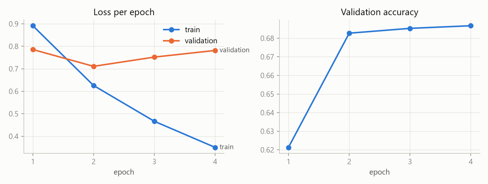
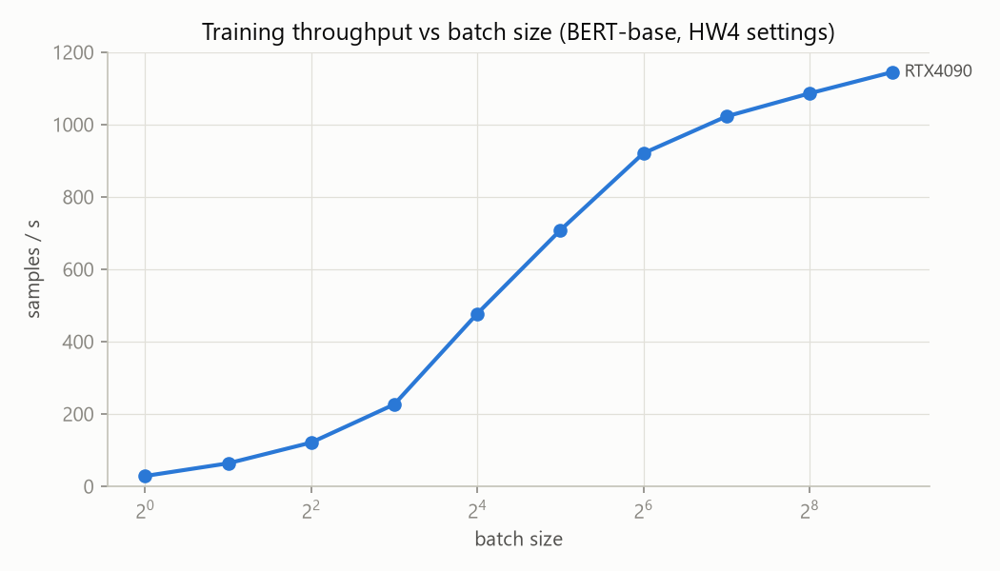
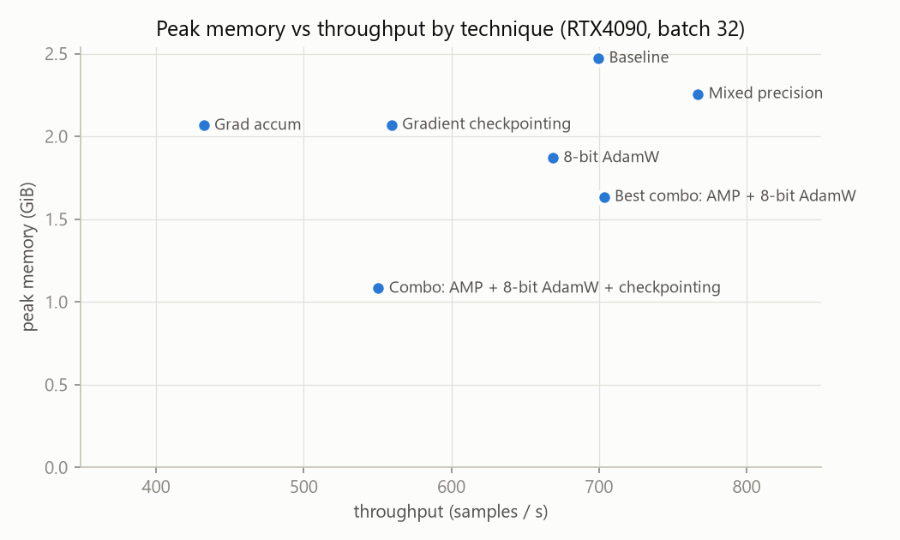

# HW4.a / HW4.5 results

## HW4.a - BERT sentiment classifier

### NVIDIA GeForce RTX 4090

**Data:** cardiffnlp/tweet_eval (sentiment), splits train+validation+test concatenated. Working subset = rows **384-5383** (0-based, inclusive; 5000 rows, 0 dropped as empty). SEED=1384. Split 70/15/15 -> 3500/750/750 (stratified). Classes: {'negative': 779, 'neutral': 2283, 'positive': 1938}.

| Epoch | Train loss | Val loss | Val acc | Epoch time (s) | samp/s |
|---|---|---|---|---|---|
| 1 | 0.8913 | 0.7855 | 0.6213 | 5.29 | 661.5 |
| 2 | 0.6255 | 0.7108 | 0.6827 | 4.92 | 711.1 |
| 3 | 0.4663 | 0.7519 | 0.6853 | 5.04 | 695.0 |
| 4 | 0.3503 | 0.7814 | 0.6867 | 5.02 | 697.4 |

Validation loss stopped improving after **epoch 2**. Training continued 2 epoch(s) past that point, costing 10.06 s of GPU time; validation loss rose from 0.7108 to 0.7814 and test accuracy went from 0.6907 (best checkpoint) to 0.688 (final epoch).

**Test accuracy:** 0.6907 (best-validation checkpoint; 0.6907 after save and reload).

Confusion matrix (rows = true, columns = predicted):

| true \ pred | negative | neutral | positive |
|---|---|---|---|
| negative | 73 | 35 | 9 |
| neutral | 35 | 238 | 69 |
| positive | 11 | 73 | 207 |

| Class | Precision | Recall | F1 | Support |
|---|---|---|---|---|
| negative | 0.6134 | 0.6239 | 0.6186 | 117 |
| neutral | 0.6879 | 0.6959 | 0.6919 | 342 |
| positive | 0.7263 | 0.7113 | 0.7188 | 291 |

**Worst class: negative** (lowest F1). Five misclassified test examples:

| Row | Tweet | True -> Pred | Diagnosis |
|---|---|---|---|
| 481 | @user even I didn't know it's 18th sept at KL Live to be exact :p | negative -> neutral | No negative words at all and a playful ':p'; the gold 'negative' label looks debatable, so neutral is a defensible prediction. |
| 5017 | Assam Congress leader Nilomoni sen deka reffered Smritini Irani as PM's 2nd wife..And Still Rahul Gandhi talks about women Empowerment. | negative -> neutral | Negativity is carried by irony around a factual report full of names; the model reads the surface as news-like and neutral. |
| 2512 | Don't want to hear Seth Rollins Speech about how great he is tomorrow bruh. | negative -> positive | Negation scoping: the model latched onto 'how great he is' and missed that 'Don't want to hear' reverses the sentiment. |
| 4768 | "Not happy that I'm working through the advance screening tomorrow, so still have to wait OVER TWO WEEKS to see Paper Towns #wallofcow" | negative -> neutral | Explicit 'Not happy' is outweighed by positive-context words such as advance screening and seeing Paper Towns. |
| 5144 | @user Hi, was offered the 6 months free Netflix last Tuesday and was told it takes 5 days to receive a code but haven't got anything" | negative -> neutral | The complaint is phrased as a polite factual timeline rather than with explicit sentiment words. |

Custom inference with the reloaded model:

| Text | Prediction | Probabilities |
|---|---|---|
| just landed and my bag is already at the carousel, best flight ever | positive | {'negative': 0.02, 'neutral': 0.035, 'positive': 0.944} |
| three hours on the tarmac and nobody tells us anything | negative | {'negative': 0.516, 'neutral': 0.409, 'positive': 0.075} |
| the meeting got moved to thursday | neutral | {'negative': 0.084, 'neutral': 0.805, 'positive': 0.111} |
| oh great, another monday. exactly what i needed | positive | {'negative': 0.017, 'neutral': 0.054, 'positive': 0.929} |

**HW4.5 baseline:** peak GPU memory **2.472 GiB** allocated, **2.967 GiB** reserved, wall-clock training time **21.5 s**, batch size 32, 4 epochs, fp32, AdamW, learning rate 2e-5.

## HW4.a - Table HW4.1 Serving comparison

### RTX4090 - Qwen/Qwen2.5-1.5B-Instruct, 128 new tokens/request, bf16

| Configuration | Tokens/sec | p50 latency (ms) | p95 latency (ms) |
|---|---|---|---|
| HF pipeline, batch 1 | 63.1 | 2021.3 | 2092.0 |
| vLLM, batch 1 | 206.7 | 618.5 | 627.9 |
| vLLM, batch 8 | 1391.8 | 733.5 | 756.2 |
| vLLM, batch 32 | 5434.2 | 761.3 | 769.0 |

At the batch sizes tested, vLLM per-request latency never exceeded the HF baseline.

## HW4.5 Part A - Batch scaling to the memory wall

### NVIDIA GeForce RTX 4090 (23.99 GiB)

| Batch | Throughput (samp/s) | Peak alloc (GiB) | Peak reserved (GiB) | Time/epoch (s) |
|---|---|---|---|---|
| 1 | 28.9 | 2.061 | 2.279 | 121.1 |
| 2 | 63.9 | 2.062 | 2.279 | 54.81 |
| 4 | 121.3 | 2.067 | 2.336 | 28.87 |
| 8 | 226.7 | 2.066 | 2.270 | 15.44 |
| 16 | 477.5 | 2.088 | 2.264 | 7.33 |
| 32 | 708.2 | 2.472 | 2.770 | 4.94 |
| 64 | 920.8 | 3.726 | 4.012 | 3.80 |
| 128 | 1022.7 | 6.110 | 6.275 | 3.42 |
| 256 | 1086.3 | 10.978 | 11.125 | 3.22 |
| 512 | 1145.3 | 20.591 | 20.766 | 3.06 |

Largest batch that runs: **512** (OOM at 1024). Throughput reaches 95% of its peak at **batch 512** and stops improving meaningfully beyond that point.

Only the RTX 4090 was measured because the second-GPU experiment was optional and was not performed. Therefore, a cross-card comparison and maximum-batch ratio are not reported.

## HW4.5 Part B - Memory techniques, one at a time

### Table HW4.5.1 - NVIDIA GeForce RTX 4090 (23.99 GiB)

Throughput and peak memory are measured at the HW4 batch size of 32 so that the techniques do equal work. Maximum batch is the largest power of two before OOM. Accuracy is from a full HW4 fine-tune with only that technique enabled.

| Technique | Max batch | Throughput (samp/s) | Peak memory (GiB) | Eval accuracy |
|---|---|---|---|---|
| Baseline (HW4 settings) | 512 | 699.6 | 2.472 | 0.688 |
| Mixed precision (bf16) | 512 | 767.0 | 2.256 | 0.6893 |
| Gradient checkpointing | 2048 | 559.5 | 2.070 | 0.688 |
| Gradient accumulation (8 x 16) | 128 effective | 432.3 | 2.066 | 0.6747 |
| 8-bit AdamW | 512 | 668.8 | 1.870 | 0.684 |
| Best combo: AMP + 8-bit AdamW | 512 | 703.4 | 1.635 | 0.6867 |
| AMP + 8-bit AdamW + checkpointing | 4096 | 550.6 | 1.082 | 0.6867 |

Gradient accumulation reached effective batch **128** using a physical batch of 8. Wall-clock time for 20 optimizer steps was **5.922 s** with 2.066 GiB peak memory, compared with 2.507 s and 6.11 GiB for direct batch 128. Test accuracy was 0.6747 because the unchanged learning rate produced fewer optimizer steps per epoch.

**Ranking: memory saved per unit of throughput lost:**

| Rank | Technique | Memory saved (GiB) | Throughput lost | GiB per 1% lost |
|---|---|---|---|---|
| 1 | Mixed precision (bf16) | +0.22 | No loss | Best overall |
| 2 | 8-bit AdamW | +0.60 | 4.4% | 0.137 |
| 3 | Gradient accumulation | +4.04 | 57.7% | 0.070 |
| 4 | Gradient checkpointing | +0.40 | 20.0% | 0.020 |

Gradient checkpointing reduced throughput from 699.6 to 559.5 samples/s, a **20.0% slowdown**, while reducing memory from 2.472 to 2.070 GiB at batch 32.

## HW4.5 Part C - Two cards at once (DDP)

Single-GPU DDP baseline on the NVIDIA RTX 4090. The two-GPU pairing was confirmed optional by the TA on 2026-10-22 and was not run because the lab machine had one GPU.

| Batch/GPU | Throughput (samp/s) | Step (ms) | Compute (ms) | Comm overhead (ms) | Peak memory (GiB) |
|---|---|---|---|---|---|
| 8 | 163.0 | 49.09 | 54.59 | 0.0 | 2.065 |
| 16 | 296.2 | 54.02 | 46.51 | 7.51 | 2.086 |
| 32 | 588.2 | 54.40 | 50.41 | 4.00 | 2.467 |
| 64 | 932.2 | 68.65 | 67.34 | 1.31 | 3.714 |
| 128 | 1036.0 | 123.55 | 123.37 | 0.18 | 6.088 |
| 256 | 1094.0 | 234.00 | 236.48 | 0.00 | 10.935 |

With one GPU there is no gradient all-reduce, so the communication-overhead column is the timing noise floor of the method. Small batches are launch-bound and vary between runs; batch sizes 64 and above are more representative.

## HW4.5 Part D - Serving rerun on real hardware

### RTX4090 - Qwen/Qwen2.5-1.5B-Instruct, 128 new tokens/request, bf16

| Configuration | Tokens/sec | p50 latency (ms) | p95 latency (ms) |
|---|---|---|---|
| HF pipeline, batch 1 | 62.9 | 2025.1 | 2112.6 |
| vLLM, batch 1 | 203.8 | 626.1 | 646.3 |
| vLLM, batch 8 | 1380.8 | 738.3 | 771.0 |
| vLLM, batch 32 | 5546.5 | 739.1 | 740.1 |

At the batch sizes tested, vLLM per-request latency never exceeded the HF baseline.

### KV-cache memory versus context length

**NVIDIA GeForce RTX 4090, HF Transformers, batch 8**, Qwen/Qwen2.5-1.5B-Instruct:

| Context | KV measured (GiB) | KV analytic (GiB) | Peak total (GiB) |
|---|---|---|---|
| 1024 | 0.227 | 0.219 | 3.607 |
| 2048 | 0.445 | 0.438 | 3.828 |
| 3072 | 0.664 | 0.656 | 4.049 |
| 4096 | 0.883 | 0.875 | 4.268 |
| 8192 | 1.758 | 1.750 | 5.260 |
| 16384 | 3.508 | 3.500 | 7.518 |
| 32768 | 7.008 | 7.000 | 12.033 |
| 58368 | 12.477 | 12.469 | 19.089 |

Longest context at batch 8 before OOM with HF Transformers: **58,368 tokens**.

For vLLM, the KV pool contained 677,440 tokens, equivalent to 18.09 GiB at `gpu_memory_utilization=0.9`. At batch size 8, memory allowed 84,680 tokens per sequence, but the model supports only 32,768 positions. Therefore, the longest model-supported context was **32,768 tokens**.

## HW4.5 Part E - Analysis and summary

One full fine-tune uses the 70% training share of all 59,899 rows:

- 59,899 x 70% = 41,929 training samples
- 41,929 x 4 epochs = 167,716 training samples
- 167,716 / 767.0 samples/s = 219 seconds
- 219 / 3,600 = **0.06 GPU-hours**

I would use bf16 mixed precision at the original batch size of 32. It was the fastest measured configuration with recorded accuracy, reaching 767.0 samples/s and 0.6893 accuracy compared with 0.6880 for the fp32 baseline. It also reduced peak memory from 2.472 to 2.256 GiB without changing the overall training recipe.

## Written answers

These answers are based on the measured results saved in `results/` and the run records in `RUN_LOG.txt`.

### HW4.a - Serving: latency versus throughput

On the RTX 4090, per-request latency never became worse than the HF pipeline baseline at the tested batch sizes. vLLM p50 latency increased from 618.5 ms at batch 1 to 733.5 ms at batch 8 and 761.3 ms at batch 32, but it remained below the HF baseline of 2,021.3 ms. Total throughput increased from 206.7 tokens/s to 5,434.2 tokens/s. For an interactive application, p95 per-request latency matters more because it determines how long an individual user waits.

### Part A - Where throughput stops improving

Throughput increased almost linearly through batch 16, then the gains became smaller as batch size increased. Using the 95%-of-peak rule, throughput stopped improving meaningfully at batch 512 on the RTX 4090. Only the RTX 4090 was measured because the second-GPU experiment was optional and was not performed, so a cross-card comparison and maximum-batch ratio are not reported.

The maximum-batch ratio would not necessarily equal the VRAM ratio because GPU memory includes both fixed and batch-dependent components. Model weights, gradients, optimizer state, and CUDA overhead consume a fixed amount, while activations grow with batch size. Therefore, additional VRAM does not translate directly into the same proportional increase in maximum batch size.

### Part B - Memory technique recommendation

I would apply mixed precision first because it reduced memory and improved throughput while preserving accuracy. At batch 32, mixed precision improved throughput from 699.6 to 767.0 samples/s and reduced peak allocated memory from 2.472 to 2.256 GiB. Its evaluation accuracy was 0.6893 compared with 0.6880 for the baseline.

On a 32 GB card, I would not use gradient checkpointing for this workload because the baseline already fits comfortably at batch 32 and remains below the card limit at batch 512. Checkpointing reduced throughput by 20.0% at batch 32 while saving only about 0.4 GiB. It would become more valuable for a larger model or a larger sequence length.

### Part C - Two-GPU limitation

The TA confirmed that the two-GPU pairing was optional. The available lab machine had one RTX 4090, so only the single-GPU DDP baseline was run. As a result, two-GPU throughput, scaling efficiency, interconnect bandwidth, and the batch size at which multi-GPU becomes worthwhile were not measured.

The single-GPU result still provides a baseline: at batch sizes 64 and above, it reproduced the Part A throughput within approximately 2%. The reported communication overhead is a timing noise floor because no all-reduce operation was required.

### Part D - Serving comparison

The HW4.5 serving rerun matched the HW4.a numbers within approximately 2% because both runs used the same RTX 4090, bf16 precision, model, and generation length. For example, vLLM batch 32 throughput changed from 5,434.2 to 5,546.5 tokens/s.

KV-cache memory grew linearly with context length. At batch size 8, HF Transformers reached 58,368 tokens before running out of memory, while vLLM's memory pool could support approximately 84,680 tokens per sequence. The model's own maximum context length is 32,768 tokens, so that is the longest supported context on this GPU.

### Part E - Final configuration

The recommended full-fine-tune configuration is bf16 mixed precision with batch size 32. It had the highest measured throughput among configurations with recorded accuracy, preserved accuracy relative to the baseline, and reduced peak memory. The full fine-tune is estimated to use approximately 0.06 GPU-hours on one RTX 4090, excluding validation passes.
